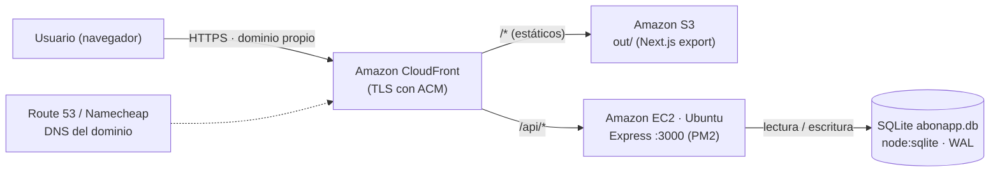
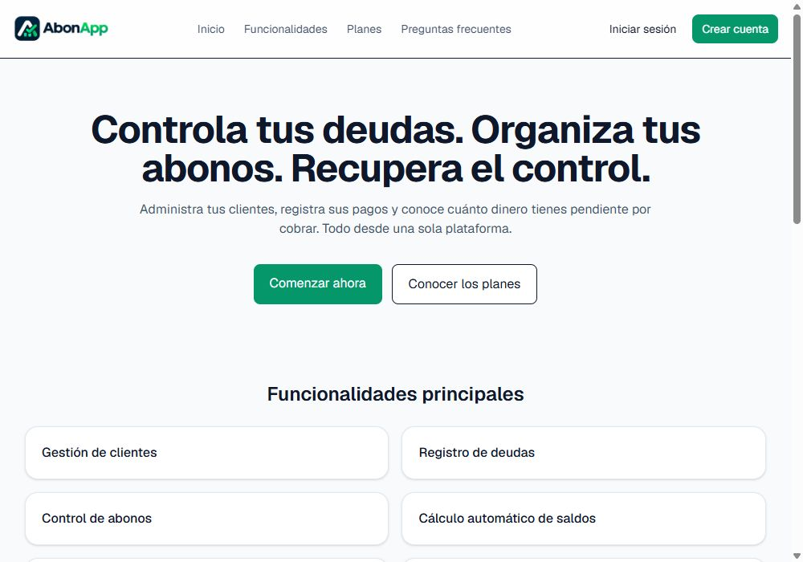

# AbonApp — Control de deudas y abonos

**AbonApp** es una aplicación web tipo SaaS para pequeños emprendimientos: permite administrar clientes, registrar deudas, controlar abonos parciales o totales y consultar el estado financiero de la cartera en tiempo real.

> **Aplicación en producción:** <https://abonapp.tu-dominio.com>
>
> *(Reemplaza este dominio por el dominio real configurado en CloudFront/Route 53 antes de la entrega. No se aceptan IP, puertos ni localhost.)*

---

## Información académica

- **Universidad:** Universidad Nacional Abierta y a Distancia (UNAD)
- **Programa / asignatura:** `[POR COMPLETAR: programa y semestre]`
- **Integrantes:**
  - Abraham Marín — [@amarinr786-droid](https://github.com/amarinr786-droid)
  - Jayri Nicole Barreto Polo — `[POR COMPLETAR: usuario de GitHub]`
  - `[POR COMPLETAR: tercer integrante — usuario de GitHub]`
- **Corte:** 3

---

## 1. Flujo de la aplicación y control de acceso

La primera vista es una **landing page pública** (`/`) y el acceso a los datos está protegido con **sesiones en cookie `httpOnly`** emitidas por el backend. El dashboard y las rutas de clientes, deudas y abonos nunca quedan abiertos al público.

1. **Landing page (`/`)**: presentación del servicio, funcionalidades, planes académicos (`Gratuito`, `Básico`, `Profesional`) y llamados a registro/inicio de sesión.
2. **Autenticación (`/login` y `/register`)**: registro y login contra `/api/auth/*`. La contraseña se guarda con `bcrypt` y la sesión viaja en una cookie `httpOnly` (el JavaScript del navegador no puede leer el token).
3. **Dashboard (`/dashboard`)**: indicadores de clientes, total en deudas, total abonado, saldo pendiente y últimos movimientos.
4. **Clientes (`/dashboard/clientes`)**: CRUD con búsqueda por nombre y bloqueo de eliminación si el cliente tiene deudas.
5. **Deudas (`/dashboard/deudas` y `/dashboard/deudas/detalle/?id=...`)**: creación, edición, filtro por estado (`pendiente`, `parcial`, `pagada`), anulación sin abonos y detalle con historial.
6. **Abonos (`/dashboard/abonos`)**: historial con filtros por cliente y fechas. Al registrar un abono, el servidor recalcula `total_abonado`, `saldo_pendiente` y `estado`.
7. **Mi plan y configuración (`/dashboard/plan`, `/dashboard/configuracion`)**: plan activo (simulado, sin cobros), edición de perfil y cambio de contraseña.

---

## 2. Arquitectura e infraestructura (AWS)



**Por qué CloudFront delante de todo:** el frontend y la API quedan bajo el **mismo origen** (`https://dominio.com` y `https://dominio.com/api`). Así la cookie de sesión no es de terceros, el navegador no la bloquea y el build puede usar `NEXT_PUBLIC_API_URL=/api`.

| Servicio | Función en el proyecto |
|---|---|
| **Amazon S3** | Aloja los archivos estáticos generados en `abonapp/out/` (HTML, JS, CSS, fuentes). |
| **Amazon CloudFront** | CDN + HTTPS con certificado ACM, dominio personalizado y ruteo de `/api/*` hacia EC2. |
| **Amazon EC2 (Ubuntu 24.04)** | Ejecuta la API REST de Express con PM2 y persiste `abonapp.db` en el volumen EBS. |
| **SQLite (`node:sqlite`)** | Base de datos embebida en un archivo, con `WAL` y `PRAGMA foreign_keys = ON`. |
| **Route 53 / Namecheap** | DNS del dominio personalizado (registro A/ALIAS o CNAME hacia CloudFront). |
| **AWS IAM** | Usuario/rol con permisos mínimos para que GitHub Actions sincronice S3 e invalide CloudFront. |
| **GitHub Actions** | CI (lint, build, tests) y CD (S3 + CloudFront + EC2) descritos en `.github/workflows/`. |

### Variables de entorno del backend

| Variable | Ejemplo | Para qué sirve |
|---|---|---|
| `PORT` | `3000` | Puerto de Express. |
| `FRONTEND_URL` | `https://abonapp.tu-dominio.com` | Origen permitido por CORS (con credenciales). |
| `SESSION_SECRET` | cadena larga y aleatoria | Firma de la cookie de sesión. |
| `COOKIE_SECURE` | `true` en producción | Cookie `Secure` + `SameSite=None` (obligatorio con HTTPS). |
| `NODE_ENV` | `production` | Modo de ejecución. |
| `DB_PATH` | `./abonapp.db` (opcional) | Ruta alternativa de SQLite (útil en pruebas). |

---

## 3. Tecnologías utilizadas

### Frontend (`abonapp/`)

| Tecnología | Versión | Uso |
|---|---|---|
| **Next.js** | `16.4.6` | App Router, Turbopack y exportación estática (`output: "export"`, `trailingSlash: true`). |
| **React / React DOM** | `19.3.0` | Componentes, formularios, modales y estado local. |
| **TypeScript** | `^5` | Tipado de `Usuario`, `Cliente`, `Deuda`, `Abono` y `ResumenDashboard`. |
| **Tailwind CSS** | `4.3.3` | Estilos utilitarios con `@tailwindcss/turbopack`. |
| **ESLint** | `^9` | Calidad de código con `eslint-config-next`. |
| **React Context API** | Integrado | Sesión global en `AuthContext`, sin librerías externas. |
| **Fetch API** | Nativo | Cliente centralizado en `lib/api.ts` con `credentials: "include"`. |

### Backend (`backend/`)

| Tecnología | Versión | Uso |
|---|---|---|
| **Node.js** | `>=24` | Requerido por el módulo nativo `node:sqlite`. |
| **Express** | `^4.19.2` | API REST (`/api/auth`, `/api/clientes`, `/api/deudas`, `/api/abonos`, `/api/dashboard`). |
| **SQLite (`node:sqlite`)** | Nativo | `DatabaseSync`, modo WAL y llaves foráneas. |
| **express-session** | `^1.18.0` | Sesiones con cookie `httpOnly`. |
| **bcryptjs** | `^2.4.3` | Hash y verificación de contraseñas. |
| **cors** | `^2.8.5` | CORS con credenciales para el dominio del frontend. |

---

## 4. Estructura del proyecto

```text
AbonApp/
├── .github/
│   └── workflows/
│       ├── ci.yml                     # Integración continua (lint, build, tests)
│       └── deploy.yml                 # Despliegue a S3 + CloudFront + EC2
├── abonapp/                           # Frontend Next.js (exportación estática)
│   ├── next.config.ts                 # output: "export", trailingSlash, Turbopack CSS
│   ├── app/
│   │   ├── layout.tsx                 # Layout raíz + AuthProvider
│   │   ├── page.tsx                   # Landing page (componente principal)
│   │   ├── login/page.tsx
│   │   ├── register/page.tsx
│   │   └── dashboard/
│   │       ├── layout.tsx             # Layout protegido + Sidebar
│   │       ├── page.tsx               # Resumen financiero
│   │       ├── clientes/page.tsx
│   │       ├── deudas/page.tsx
│   │       ├── deudas/detalle/        # Detalle vía ?id= (compatible con S3)
│   │       ├── abonos/page.tsx
│   │       ├── plan/page.tsx
│   │       └── configuracion/page.tsx
│   ├── components/                    # Formularios, Modal, Sidebar, EstadoBadge
│   ├── context/AuthContext.tsx
│   ├── lib/
│   │   ├── api.ts                     # Cliente fetch -> NEXT_PUBLIC_API_URL
│   │   ├── plans.ts
│   │   ├── types.ts
│   │   └── services/                  # auth, clientes, deudas, abonos, dashboard
│   └── out/                           # Estáticos generados por `npm run build` (ignorado en Git)
├── backend/
│   ├── .env.example
│   ├── src/
│   │   ├── index.js                   # Express, CORS, sesión y /api/health
│   │   ├── db.js                      # SQLite + creación de tablas
│   │   ├── middleware/auth.js         # requireAuth
│   │   └── routes/                    # auth, clientes, deudas, abonos, dashboard
│   └── tests/                         # Pruebas de API con node:test
├── docs/                              # Evidencias y guía de despliegue
│   ├── DEPLOY.md
│   ├── landing.png
│   ├── login.png
│   └── dashboard.png
└── README.md
```

### ¿Dónde está cada cosa? (para la sustentación)

- **Componente principal / entrada:** `abonapp/app/page.tsx` (landing). El árbol se monta en `app/layout.tsx`.
- **Configuración de Next:** `abonapp/next.config.ts` define `output: "export"`, `trailingSlash: true`, imágenes sin optimizar y el loader de Tailwind para Turbopack.
- **Estáticos generados:** `abonapp/out/` contiene `index.html`, una carpeta por ruta (`login/`, `dashboard/`, etc.), `404.html`, y los assets en `out/_next/static/` (JS, CSS y fuentes).
- **CSS:** `app/globals.css` (Tailwind 4). **JS:** componentes `.tsx` compilados a `out/_next/static/chunks/`.
- **Detalle de deuda sin servidor Node:** se usa `/dashboard/deudas/detalle/?id=123` en lugar de una ruta dinámica, porque en S3 no hay servidor que resuelva `/deudas/[id]`.

---

## 5. Getting Started (local)

### Requisitos

- **Node.js 24 o superior** (`node -v`). El backend usa `node:sqlite`, disponible de forma estable en Node 24.
- **npm** y **Git**.

### 1) Clonar

```bash
git clone https://github.com/amarinr786-droid/AbonApp.git
cd AbonApp
```

### 2) Backend (puerto 3000)

```bash
cd backend
npm install
cp .env.example .env        # PowerShell: Copy-Item .env.example .env
npm run dev
```

Verifica: <http://localhost:3000/api/health> → `{"status":"ok"}`. La base `backend/abonapp.db` se crea sola.

### 3) Frontend (puerto 3001)

En otra terminal:

```bash
cd abonapp
npm install
cp .env.example .env.local  # PowerShell: Copy-Item .env.example .env.local
npx next dev -p 3001
```

Abre <http://localhost:3001>. El backend debe estar corriendo primero.

### 4) Pruebas

```bash
cd backend
npm test
```

---

## 6. Build y despliegue

### 6.1 Compilar el frontend

```bash
cd abonapp
# Con CloudFront y mismo dominio, la API se sirve en /api:
NEXT_PUBLIC_API_URL=/api npm run build
```

En PowerShell:

```powershell
$env:NEXT_PUBLIC_API_URL="/api"; npm run build
```

Genera `abonapp/out/`. **La variable queda incrustada en el JS**: si cambias la URL de la API, vuelve a compilar.

### 6.2 Subir el frontend a S3 + invalidar CloudFront

```bash
aws s3 sync abonapp/out/ s3://TU_BUCKET --delete
aws cloudfront create-invalidation \
  --distribution-id TU_DISTRIBUTION_ID --paths "/*"
```

El bucket debe tener habilitado **Static website hosting** con `index.html` como documento índice y `404.html` como documento de error. CloudFront entrega HTTPS y el dominio propio.

### 6.3 Desplegar el backend en EC2

```bash
cd AbonApp/backend
npm ci --omit=dev
cp .env.example .env     # editar valores reales
pm2 start src/index.js --name abonapp-api
pm2 save
```

Configuración mínima en producción:

```env
PORT=3000
FRONTEND_URL=https://abonapp.tu-dominio.com
SESSION_SECRET=<cadena aleatoria larga>
COOKIE_SECURE=true
NODE_ENV=production
```

La guía paso a paso (S3, CloudFront, ACM, DNS, Security Group, PM2 y secretos) está en **[docs/DEPLOY.md](docs/DEPLOY.md)**.

---

## 7. CI/CD: qué hace cada workflow

### `.github/workflows/ci.yml` — Integración continua

Se ejecuta en **pull requests y pushes** a `main`/`dev`. No despliega: valida que el código se pueda integrar.

| Job | Pasos | Para qué |
|---|---|---|
| **frontend** | `checkout` → `setup-node 24` (caché npm) → `npm ci` → `npm run lint` → `npm run build` con `NEXT_PUBLIC_API_URL=/api` → sube `out/` como artefacto | Detecta errores de TypeScript, ESLint y build estático antes del merge. |
| **backend** | `checkout` → `setup-node 24` → `npm ci` → `npm test` | Ejecuta las pruebas de API con `node:test` sobre una base temporal. |

### `.github/workflows/deploy.yml` — Despliegue continuo

Se ejecuta al hacer **push a `main`** o manualmente (`workflow_dispatch`). Usa el entorno `production`.

| Job | Pasos | Para qué |
|---|---|---|
| **deploy-frontend** | Instala y compila con `/api` → `configure-aws-credentials` → `aws s3 sync --delete` → `cloudfront create-invalidation` | Publica el nuevo `out/` en S3 y limpia la caché de CloudFront. |
| **deploy-backend** | `appleboy/ssh-action` → `git pull` → `npm ci --omit=dev` → `pm2 reload abonapp-api --update-env` | Actualiza el código en EC2 sin tumbar el proceso (reload de PM2). |

**Secretos del repositorio** (`Settings → Secrets and variables → Actions`):

| Secreto | Valor |
|---|---|
| `AWS_ACCESS_KEY_ID` / `AWS_SECRET_ACCESS_KEY` | Credenciales IAM con permisos de S3 y CloudFront. |
| `AWS_REGION` | Región del bucket (por ejemplo `us-east-1`). |
| `S3_BUCKET` | Nombre del bucket del frontend. |
| `CLOUDFRONT_DISTRIBUTION_ID` | ID de la distribución. |
| `EC2_HOST` / `EC2_USER` | IP o DNS público y usuario SSH (`ubuntu`). |
| `EC2_SSH_KEY` | Llave privada `.pem` del key pair de EC2. |
| `EC2_APP_DIR` | Ruta del proyecto en EC2 (por ejemplo `/home/ubuntu/AbonApp`). |

> **AWS Academy:** las credenciales del laboratorio caducan. Si el laboratorio se reinicia, actualiza los secretos `AWS_*` antes de volver a desplegar. El workflow también puede ejecutarse a mano desde la pestaña **Actions**. Mientras no existan los secretos, el job de despliegue se omite (no falla).

---

## 8. Dominio, DNS y HTTPS

1. Registrar el dominio con el **GitHub Student Developer Pack** (Namecheap, Name.com, `.tech`, etc.).
2. Crear un certificado **ACM en `us-east-1`** (requisito de CloudFront) para `abonapp.tu-dominio.com`.
3. En CloudFront, agregar el dominio alternativo y seleccionar el certificado.
4. En el DNS del proveedor:
   - **Route 53:** registro `A` tipo *Alias* hacia la distribución.
   - **Namecheap/Name.com:** `CNAME` de `abonapp` hacia `dxxxx.cloudfront.net`.
5. Forzar HTTPS y redirigir HTTP → HTTPS en CloudFront.

Con esto la app queda en `https://abonapp.tu-dominio.com`, sin IP, sin puertos y sin URLs por defecto de Netlify/Vercel.

---

## 9. Evidencias de funcionamiento




> Las capturas se generan desde la aplicación local y se guardan en `docs/`.

---

## 10. Justificación de los servicios AWS (para la sustentación)

- **S3**: almacenamiento de objetos estáticos, altamente disponible y económico; encaja con la exportación estática de Next.js.
- **CloudFront**: CDN global, terminación TLS con ACM, caché y **mismo origen** para frontend y API (soluciona las cookies de sesión).
- **EC2**: cómputo para Express; se administra con PM2 para reinicio automático y logs.
- **SQLite sobre EBS**: base embebida suficiente para el alcance académico; WAL mejora la concurrencia. En un entorno real se migraría a RDS.
- **Security Group**: expone el puerto 3000 solo a los rangos de CloudFront (o a Nginx en el puerto 80).
- **IAM**: usuario con permisos mínimos (`s3:PutObject`, `s3:DeleteObject`, `s3:ListBucket`, `cloudfront:CreateInvalidation`) para GitHub Actions.
- **Route 53 / DNS**: resolución del dominio propio y certificado válido.

---

## 11. Recursos adicionales

- [Next.js — Static Exports](https://nextjs.org/docs/app/guides/static-exports)
- [Express.js](https://expressjs.com/)
- [Node.js — `node:sqlite`](https://nodejs.org/api/sqlite.html)
- [Tailwind CSS v4](https://tailwindcss.com/docs)
- [Amazon S3 — Static website hosting](https://docs.aws.amazon.com/AmazonS3/latest/userguide/WebsiteHosting.html)
- [Amazon CloudFront — Origin access](https://docs.aws.amazon.com/AmazonCloudFront/latest/DeveloperGuide/private-content-restricting-access-to-s3.html)
- [GitHub Actions — Deploying to Amazon S3](https://docs.github.com/en/actions/deployment/deploying-to-your-cloud-provider/deploying-to-amazon-s3)
- [GitHub Student Developer Pack](https://education.github.com/pack)
- [Conventional Commits](https://www.conventionalcommits.org/es/)
