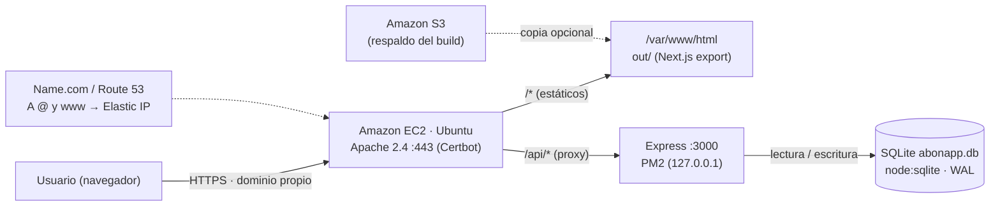
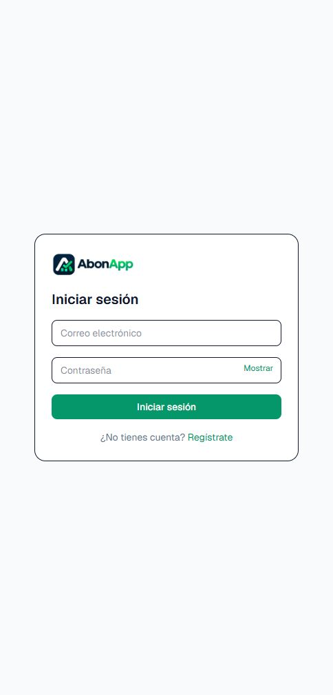
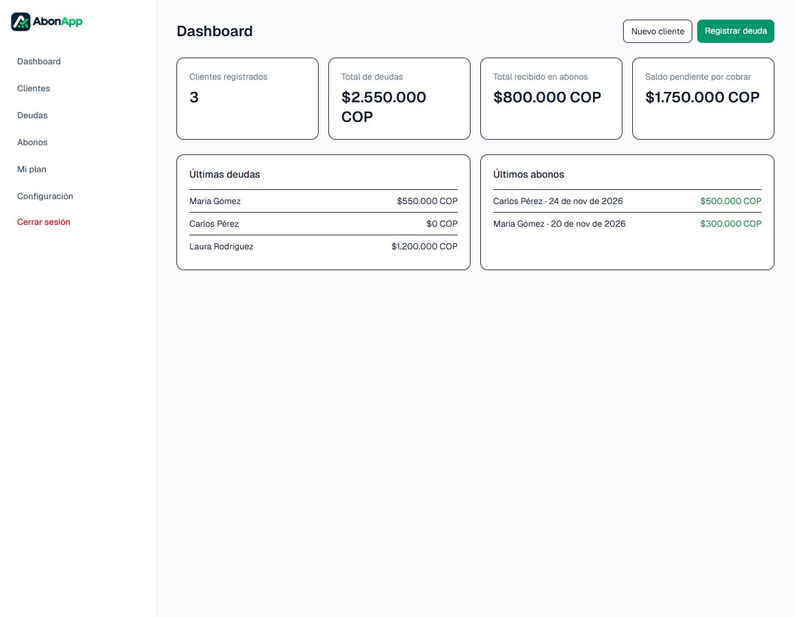

# AbonApp — Control de deudas y abonos

**AbonApp** es una aplicación web tipo SaaS para pequeños emprendimientos: permite administrar clientes, registrar deudas, controlar abonos parciales o totales y consultar el estado financiero de la cartera en tiempo real.

> **Aplicación en producción:** <https://abonapp.tech>
>
> Servida por **Apache + HTTPS (Certbot)** en una instancia **Amazon EC2**, con la API de Express en el mismo origen bajo `/api`. Sin IP, sin puertos y sin URLs por defecto de Netlify/Vercel.

---

## Información académica

- **Universidad:** Universidad de la Costa (CUC)
- **Programa / asignatura:** Buenas prácticas de desarrollo de software
- **Integrantes:**
  - Abraham Marín — [@amarinr786-droid](https://github.com/amarinr786-droid)
  - Jayri Nicole Barreto Polo — [@jayrinicolleb-boop](https://github.com/jayrinicolleb-boop)
  - Andrés Camilo Zea Tarazona — [@Azeat](https://github.com/Azeat)
  - Maria Celeste Bonilla Jaraba [@Celeste976]-https://github.com/Celeste976
- **Corte:** 3

---

## 1. Flujo de la aplicación y control de acceso

La primera vista es una **landing page pública** (`/`) y el acceso a los datos está protegido con **sesiones en cookie `httpOnly`** emitidas por el backend. El dashboard y las rutas de clientes, deudas y abonos nunca quedan abiertos al público.

1. **Landing page (`/`)**: presentación del servicio, funcionalidades, planes académicos (`Gratuito`, `Básico`, `Profesional`) y llamados a registro/inicio de sesión.
2. **Autenticación (`/login` y `/register`)**: registro y login contra `/api/auth/*`. La contraseña se guarda con `bcrypt` y la sesión viaja en una cookie `httpOnly` (el JavaScript del navegador no puede leer el token).
3. **Dashboard (`/dashboard`)**: indicadores de clientes, total en deudas, total abonado, saldo pendiente y últimos movimientos.
4. **Clientes (`/dashboard/clientes`)**: CRUD con búsqueda por nombre y bloqueo de eliminación si el cliente tiene deudas.
5. **Deudas (`/dashboard/deudas` y `/dashboard/deudas/detalle/?id=...`)**: creación, edición, filtro por estado (`pendiente`, `parcial`, `pagada`), anulación sin abonos y detalle con historial.
6. **Abonos (`/dashboard/abonos`)**: historial con filtros por cliente y fechas. Al registrar un abono, el servidor recalcula `total_abonado`, `saldo_pendiente` y `estado`.
7. **Mi plan y configuración (`/dashboard/plan`, `/dashboard/configuracion`)**: plan activo (simulado, sin cobros), edición de perfil y cambio de contraseña.

---

## 2. Arquitectura e infraestructura (AWS)



**Por qué Apache delante de Express:** el frontend estático y la API quedan bajo el **mismo origen** (`https://abonapp.tech` y `https://abonapp.tech/api`). Apache sirve `out/` y hace *reverse proxy* de `/api` hacia `127.0.0.1:3000`. Así la cookie de sesión no es de terceros, el navegador no la bloquea y el build usa `NEXT_PUBLIC_API_URL=/api`.

| Servicio | Función en el proyecto |
|---|---|
| **Amazon EC2 (Ubuntu 24.04)** | Único servidor de producción: ejecuta Apache, la API de Express con PM2 y SQLite sobre el volumen EBS. |
| **Apache 2.4** | Sirve los estáticos de `abonapp/out/` en `/var/www/html`, aplica `FallbackResource`/`ErrorDocument`, y proxya `/api` a `127.0.0.1:3000`. |
| **Certbot (Let's Encrypt)** | Certificado TLS gratuito para `abonapp.tech` y `www`, con redirección HTTP → HTTPS. |
| **Elastic IP** | IP pública fija asociada a la instancia para que el DNS no se rompa al reiniciar. |
| **SQLite (`node:sqlite`)** | Base de datos embebida en un archivo, con `WAL` y `PRAGMA foreign_keys = ON`. |
| **Amazon S3** | Almacenamiento del build estático como respaldo/evidencia; no es el origen de producción. |
| **Name.com / Route 53** | DNS del dominio personalizado (registros `A` hacia la Elastic IP). |
| **GitHub Actions** | CI (lint, build, tests) y CD (build + `scp` + `rsync` + `pm2 reload`) descritos en `.github/workflows/`. |

### Variables de entorno del backend

| Variable | Ejemplo | Para qué sirve |
|---|---|---|
| `PORT` | `3000` | Puerto de Express. |
| `FRONTEND_URL` | `https://abonapp.tech` | Origen permitido por CORS (con credenciales). |
| `SESSION_SECRET` | cadena larga y aleatoria | Firma de la cookie de sesión. |
| `COOKIE_SECURE` | `true` con HTTPS | Cookie `Secure` + `SameSite=None`; en HTTP local se usa `false` (`SameSite=Lax`). |
| `NODE_ENV` | `production` | Modo de ejecución. |
| `DB_PATH` | `./abonapp.db` (opcional) | Ruta alternativa de SQLite (útil en pruebas). |

---

## 3. Tecnologías utilizadas

### Frontend (`abonapp/`)

| Tecnología | Versión | Uso |
|---|---|---|
| **Next.js** | `16.4.6` | App Router, Turbopack y exportación estática (`output: "export"`, `trailingSlash: true`). |
| **React / React DOM** | `19.3.0` | Componentes, formularios, modales y estado local. |
| **TypeScript** | `^5` | Tipado de `Usuario`, `Cliente`, `Deuda`, `Abono` y `ResumenDashboard`. |
| **Tailwind CSS** | `4.3.3` | Estilos utilitarios con `@tailwindcss/turbopack`. |
| **ESLint** | `^9` | Calidad de código con `eslint-config-next`. |
| **React Context API** | Integrado | Sesión global en `AuthContext`, sin librerías externas. |
| **Fetch API** | Nativo | Cliente centralizado en `lib/api.ts` con `credentials: "include"`. |

### Backend (`backend/`)

| Tecnología | Versión | Uso |
|---|---|---|
| **Node.js** | `>=24` | Requerido por el módulo nativo `node:sqlite`. |
| **Express** | `^4.19.2` | API REST (`/api/auth`, `/api/clientes`, `/api/deudas`, `/api/abonos`, `/api/dashboard`). |
| **SQLite (`node:sqlite`)** | Nativo | `DatabaseSync`, modo WAL y llaves foráneas. |
| **express-session** | `^1.18.0` | Sesiones con cookie `httpOnly`. |
| **bcryptjs** | `^2.4.3` | Hash y verificación de contraseñas. |
| **cors** | `^2.8.5` | CORS con credenciales para el dominio del frontend. |

---

## 4. Estructura del proyecto

```text
AbonApp/
├── .github/
│   └── workflows/
│       ├── ci.yml                     # Integración continua (lint, build, tests)
│       └── deploy.yml                 # Despliegue a EC2 (Apache + PM2)
├── abonapp/                           # Frontend Next.js (exportación estática)
│   ├── next.config.ts                 # output: "export", trailingSlash, Turbopack CSS
│   ├── app/
│   │   ├── layout.tsx                 # Layout raíz + AuthProvider
│   │   ├── page.tsx                   # Landing page (componente principal)
│   │   ├── login/page.tsx
│   │   ├── register/page.tsx
│   │   └── dashboard/
│   │       ├── layout.tsx             # Layout protegido + Sidebar
│   │       ├── page.tsx               # Resumen financiero
│   │       ├── clientes/page.tsx
│   │       ├── deudas/page.tsx
│   │       ├── deudas/detalle/        # Detalle vía ?id= (compatible con S3)
│   │       ├── abonos/page.tsx
│   │       ├── plan/page.tsx
│   │       └── configuracion/page.tsx
│   ├── components/                    # Formularios, Modal, Sidebar, EstadoBadge
│   ├── context/AuthContext.tsx
│   ├── lib/
│   │   ├── api.ts                     # Cliente fetch -> NEXT_PUBLIC_API_URL
│   │   ├── plans.ts
│   │   ├── types.ts
│   │   └── services/                  # auth, clientes, deudas, abonos, dashboard
│   └── out/                           # Estáticos generados por `npm run build` (ignorado en Git)
├── backend/
│   ├── .env.example
│   ├── src/
│   │   ├── index.js                   # Express, CORS, sesión y /api/health
│   │   ├── db.js                      # SQLite + creación de tablas
│   │   ├── middleware/auth.js         # requireAuth
│   │   └── routes/                    # auth, clientes, deudas, abonos, dashboard
│   ├── ecosystem.config.js            # Configuración de PM2 para producción
│   └── tests/                         # Pruebas de API con node:test
├── docs/                              # Evidencias y guía de despliegue
│   ├── BITACORA.md                    # Bitácora del trabajo de cierre
│   ├── DEPLOY.md
│   ├── apache-abonapp.conf            # VirtualHost de referencia (proxy /api)
│   ├── landing.png
│   ├── login.png
│   └── dashboard.png
└── README.md
```

### ¿Dónde está cada cosa? (para la sustentación)

- **Componente principal / entrada:** `abonapp/app/page.tsx` (landing). El árbol se monta en `app/layout.tsx`.
- **Configuración de Next:** `abonapp/next.config.ts` define `output: "export"`, `trailingSlash: true`, imágenes sin optimizar y el loader de Tailwind para Turbopack.
- **Estáticos generados:** `abonapp/out/` contiene `index.html`, una carpeta por ruta (`login/`, `dashboard/`, etc.), `404.html`, y los assets en `out/_next/static/` (JS, CSS y fuentes).
- **CSS:** `app/globals.css` (Tailwind 4). **JS:** componentes `.tsx` compilados a `out/_next/static/chunks/`.
- **Detalle de deuda sin servidor de rutas:** se usa `/dashboard/deudas/detalle/?id=123` en lugar de una ruta dinámica, porque la exportación estática de Next.js no genera rutas con parámetros; el `id` se lee con `useSearchParams`.

---

## 5. Getting Started (local)

### Requisitos

- **Node.js 24 o superior** (`node -v`). El backend usa `node:sqlite`, disponible de forma estable en Node 24.
- **npm** y **Git**.

### 1) Clonar

```bash
git clone https://github.com/amarinr786-droid/AbonApp.git
cd AbonApp
```

### 2) Backend (puerto 3000)

```bash
cd backend
npm install
cp .env.example .env        # PowerShell: Copy-Item .env.example .env
npm run dev
```

Verifica: <http://localhost:3000/api/health> → `{"status":"ok"}`. La base `backend/abonapp.db` se crea sola.

### 3) Frontend (puerto 3001)

En otra terminal:

```bash
cd abonapp
npm install
cp .env.example .env.local  # PowerShell: Copy-Item .env.example .env.local
npx next dev -p 3001
```

Abre <http://localhost:3001>. El backend debe estar corriendo primero.

### 4) Pruebas

```bash
cd backend
npm test
```

---

## 6. Build y despliegue

### 6.1 Compilar el frontend

```bash
cd abonapp
# Apache sirve frontend y API bajo el mismo dominio:
NEXT_PUBLIC_API_URL=/api npm run build
```

En PowerShell:

```powershell
$env:NEXT_PUBLIC_API_URL="/api"; npm run build
```

Genera `abonapp/out/`. **La variable queda incrustada en el JS**: si cambias la URL de la API, vuelve a compilar.

### 6.2 Publicar el frontend en Apache (EC2)

```bash
# desde tu equipo
scp -i llave.pem -r abonapp/out ubuntu@IP_ELASTICA:/home/ubuntu/

# en la EC2
sudo rsync -a --delete /home/ubuntu/out/ /var/www/html/
sudo chown -R www-data:www-data /var/www/html
sudo systemctl reload apache2
```

El VirtualHost de referencia está en [`docs/apache-abonapp.conf`](docs/apache-abonapp.conf): `DocumentRoot /var/www/html`, `DirectoryIndex index.html`, `ErrorDocument 404 /404.html` y `ProxyPass /api http://127.0.0.1:3000/api`.

### 6.3 Desplegar el backend en EC2

```bash
cd ~/AbonApp/backend
npm ci --omit=dev
cp .env.example .env     # editar valores reales
pm2 start ecosystem.config.js
pm2 save
```

Configuración mínima en producción:

```env
PORT=3000
FRONTEND_URL=https://abonapp.tech
SESSION_SECRET=<cadena aleatoria larga>
COOKIE_SECURE=true
NODE_ENV=production
```

El puerto **3000 no se publica en el Security Group**: solo Apache (80/443) queda expuesto a Internet y llega a Express por `127.0.0.1`.

La guía paso a paso (EC2, Apache, Certbot, DNS, Security Group, PM2 y secretos) está en **[docs/DEPLOY.md](docs/DEPLOY.md)**.

---

## 7. CI/CD: qué hace cada workflow

### `.github/workflows/ci.yml` — Integración continua

Se ejecuta en **pull requests y pushes** a `main`/`dev`. No despliega: valida que el código se pueda integrar.

| Job | Pasos | Para qué |
|---|---|---|
| **frontend** | `checkout` → `setup-node 24` (caché npm) → `npm ci` → `npm run lint` → `npm run build` con `NEXT_PUBLIC_API_URL=/api` → sube `out/` como artefacto | Detecta errores de TypeScript, ESLint y build estático antes del merge. |
| **backend** | `checkout` → `setup-node 24` → `npm ci` → `npm test` | Ejecuta las pruebas de API con `node:test` sobre una base temporal. |

### `.github/workflows/deploy.yml` — Despliegue continuo

Se ejecuta al hacer **push a `main`** o manualmente (`workflow_dispatch`). Primero comprueba si existen los secretos de EC2: si no existen, los jobs se **omiten** con un aviso (no fallan).

| Job | Pasos | Para qué |
|---|---|---|
| **check-secrets** | Lee `EC2_HOST` y publica `configured=true/false` | Evita despliegues en rojo mientras el laboratorio no esté configurado. |
| **deploy-frontend** | `npm ci` → `npm run build` con `/api` → `appleboy/scp-action` a `/tmp/abonapp-out` → `rsync` a `WEB_ROOT` → `systemctl reload apache2` → `curl /api/health` | Publica el nuevo `out/` en Apache y verifica que la API responde. |
| **deploy-backend** | `appleboy/ssh-action` → `git pull` → `npm ci --omit=dev` → `pm2 startOrReload ecosystem.config.js --update-env` → `pm2 save` → `curl :3000/api/health` | Actualiza el código en EC2 sin tumbar el proceso (reload de PM2). |

**Secretos del repositorio** (`Settings → Secrets and variables → Actions`):

| Secreto | Valor |
|---|---|
| `EC2_HOST` | IP pública o Elastic IP de la instancia (`98.93.63.119`). |
| `EC2_USER` | Usuario SSH (`ubuntu`). |
| `EC2_SSH_KEY` | Contenido completo de la llave privada `.pem` del key pair. |
| `EC2_APP_DIR` | Ruta del proyecto en EC2 (`/home/ubuntu/AbonApp`). |
| `WEB_ROOT` | Document root de Apache (`/var/www/html`). |

> **AWS Academy:** la instancia se detiene al cerrar el laboratorio y la IP pública puede cambiar. Asocia una **Elastic IP**, actualiza `EC2_HOST` si cambia y ejecuta el workflow a mano desde la pestaña **Actions**. El despliegue manual con `scp`/`rsync` de la sección 6 sigue disponible como respaldo.

---

## 8. Dominio, DNS y HTTPS

1. Registrar el dominio con el **GitHub Student Developer Pack** (Namecheap, Name.com, `.tech`, etc.). En este proyecto: **`abonapp.tech`** (plan básico, sin add-ons).
2. Asociar una **Elastic IP** a la instancia EC2.
3. En el DNS del proveedor (Name.com → DNS Records):
   - `A` — host `@` — valor **Elastic IP**
   - `A` — host `www` — valor **Elastic IP**
4. Verificar la propagación: `nslookup abonapp.tech`.
5. En la EC2, emitir el certificado y forzar HTTPS:

```bash
sudo apt install certbot python3-certbot-apache -y
sudo certbot --apache -d abonapp.tech -d www.abonapp.tech --redirect
```

6. Cambiar `COOKIE_SECURE=true` en `backend/.env` y recargar:

```bash
pm2 restart abonapp-api --update-env
```

Con esto la app queda en `https://abonapp.tech`, sin IP, sin puertos y sin URLs por defecto de Netlify/Vercel. El certificado de Let's Encrypt se renueva solo (timer de `certbot`).

---

## 9. Evidencias de funcionamiento






> Las capturas se generan desde la aplicación local y se guardan en `docs/`.

---

## 10. Justificación de los servicios AWS (para la sustentación)

- **EC2**: cómputo para Apache y Express; se administra con PM2 para reinicio automático y logs.
- **Apache 2.4**: servidor web maduro, sirve el export estático y hace *reverse proxy* de `/api`, manteniendo un solo origen y cookies funcionales.
- **Certbot / Let's Encrypt**: TLS gratuito y renovación automática, sin depender de un balanceador.
- **Elastic IP**: IP pública estable para que el DNS del dominio no cambie.
- **SQLite sobre EBS**: base embebida suficiente para el alcance académico; WAL mejora la concurrencia. En un entorno real se migraría a RDS.
- **Security Group**: expone solo **22** (restringido a la IP del administrador) y **80/443**; el puerto **3000 nunca se abre a Internet**.
- **S3 (respaldo)**: conserva una copia del build estático como evidencia y respaldo; la entrega se sirve desde EC2 con dominio propio y HTTPS.
- **DNS**: resolución del dominio propio (`A @` y `A www` hacia la Elastic IP).

---

## 11. Recursos adicionales

- [Bitácora de la entrega final](docs/BITACORA.md) — cambios, correcciones y verificación.
- [Guía de despliegue](docs/DEPLOY.md) — pasos reproducibles en AWS.
- [Next.js — Static Exports](https://nextjs.org/docs/app/guides/static-exports)
- [Express.js](https://expressjs.com/)
- [Node.js — `node:sqlite`](https://nodejs.org/api/sqlite.html)
- [Tailwind CSS v4](https://tailwindcss.com/docs)
- [Apache HTTP Server — mod_proxy](https://httpd.apache.org/docs/2.4/mod/mod_proxy.html)
- [Certbot — Apache](https://certbot.eff.org/instructions?ws=apache&os=ubuntufocal)
- [PM2 — Process Manager](https://pm2.keymetrics.io/docs/usage/quick-start/)
- [GitHub Actions — Deploying to Amazon EC2](https://docs.github.com/en/actions/deployment/deploying-to-your-cloud-provider/deploying-to-amazon-ec2)
- [GitHub Student Developer Pack](https://education.github.com/pack)
- [Conventional Commits](https://www.conventionalcommits.org/es/)
