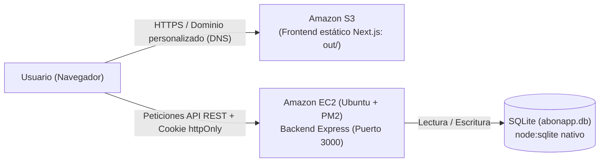

<<<<<<< HEAD
# AbonApp — Control de Deudas y Abonos

**AbonApp** es una aplicación web SaaS diseñada para pequeños emprendimientos y negocios que necesitan administrar sus clientes, registrar deudas, controlar abonos parciales o totales y visualizar el estado financiero de su cartera en tiempo real.

> **Enlace a la aplicación en producción:** `[POR COMPLETAR: https://tu-dominio-personalizado.tech]` *(configurado con dominio personalizado y DNS, sin IP pública ni puertos)*

---

## Información Académica

- **Universidad:** `[POR COMPLETAR: Nombre de tu universidad]`
- **Programa / Asignatura:** `[POR COMPLETAR: Nombre de la materia / semestre]`
- **Integrantes / Colaboradores:**
  - `[POR COMPLETAR: Nombre completo — @usuarioGitHub]`
  - `[POR COMPLETAR: Nombre completo — @usuarioGitHub]`

---

## Flujo de la Aplicación y Control de Acceso

La aplicación implementa control de acceso basado en sesiones (`httpOnly` cookies) de modo que el dashboard y los datos de clientes/deudas nunca quedan expuestos al público:

1. **Landing Page (`/`)**: Presentación del servicio, funcionalidades principales, planes académicos (`Gratuito`, `Básico`, `Profesional`) y acceso a registro o inicio de sesión.
2. **Autenticación (`/login` y `/register`)**: Registro de cuenta y autenticación contra el backend (`/api/auth/login` y `/api/auth/register`).
3. **Dashboard (`/dashboard`)**: Resumen con indicadores clave (clientes registrados, total en deudas, total recibido en abonos, saldo pendiente) y últimos movimientos.
4. **Clientes (`/dashboard/clientes`)**: CRUD de clientes con búsqueda por nombre y validación para impedir eliminar clientes con deudas asociadas.
5. **Deudas (`/dashboard/deudas` y `/dashboard/deudas/detalle/?id=...`)**: Creación, edición, filtrado por estado (`pendiente`, `parcial`, `pagada`), anulación de deudas sin abonos y vista de detalle.
6. **Abonos (`/dashboard/abonos`)**: Historial general de pagos con filtros por cliente y rango de fechas; al registrar un abono, el servidor recalcula automáticamente `totalAbonado`, `saldoPendiente` y `estado`.
7. **Mi Plan y Configuración (`/dashboard/plan` y `/dashboard/configuracion`)**: Consulta del plan activo, actualización de perfil y cambio de contraseña.

---

## Arquitectura e Infraestructura (AWS)



- **Amazon S3 (Static Website Hosting):** Aloja los archivos estáticos (`HTML`, `CSS`, `JS`) generados por Next.js en `abonapp/out/`.
- **Amazon EC2 (Ubuntu 24.04):** Ejecuta la API REST en Node.js + Express administrada con **PM2**.
- **SQLite (`node:sqlite`):** Base de datos relacional ligera almacenada en `backend/abonapp.db` con modo `WAL` y llaves foráneas activas (`PRAGMA foreign_keys = ON`).

---

## Tecnologías Utilizadas

### Frontend (`abonapp/`)
- **Next.js `16.4.6`** (App Router, Turbopack, exportación estática `output: "export"`).
- **React `19.3.0`** y **React DOM `19.3.0`**.
- **TypeScript `^5`**.
- **Tailwind CSS `4.3.3`** con `@tailwindcss/turbopack`.
- **ESLint `^9`** + `eslint-config-next`.
- **React Context API** (`AuthContext`) y **Fetch API** (`credentials: "include"`).

### Backend (`backend/`)
- **Node.js `v24+`** (módulo nativo `node:sqlite`).
- **Express `^4.19.2`**.
- **express-session `^1.18.0`** (sesiones seguras mediante cookies `httpOnly`).
- **bcryptjs `^2.4.3`** (cifrado de contraseñas).
- **cors `^2.8.5`**.

---

## Estructura del Proyecto y Archivos Clave

```text
AbonApp/
├── abonapp/                          # Frontend Next.js (exportación estática)
│   ├── next.config.ts                # Configura output: "export", trailingSlash: true y loader CSS de Turbopack
│   ├── package.json                  # Scripts (dev, build, start, lint) y dependencias
│   ├── app/
│   │   ├── layout.tsx                # Layout raíz: fuentes Geist, metadata y <AuthProvider>
│   │   ├── globals.css               # Estilos globales y variables de tema Tailwind CSS 4
│   │   ├── page.tsx                  # Componente principal de entrada (Landing Page en /)
│   │   ├── login/page.tsx            # Inicio de sesión
│   │   ├── register/page.tsx         # Registro de usuario
│   │   └── dashboard/
│   │       ├── layout.tsx            # Layout protegido del panel con <Sidebar />
│   │       ├── page.tsx              # Resumen e indicadores del dashboard
│   │       ├── clientes/page.tsx     # Gestión de clientes
│   │       ├── deudas/page.tsx       # Listado y gestión de deudas
│   │       ├── deudas/detalle/       # Detalle de deuda (vía query param ?id= para soporte estático en S3)
│   │       ├── abonos/page.tsx       # Historial general de abonos
│   │       ├── plan/page.tsx         # Vista de Mi Plan
│   │       └── configuracion/page.tsx# Edición de perfil y contraseña
│   ├── components/                   # Componentes reutilizables (formularios, Modal, Sidebar, EstadoBadge)
│   ├── context/AuthContext.tsx       # Estado global de autenticación
│   ├── lib/
│   │   ├── api.ts                    # Cliente fetch centralizado apuntando a NEXT_PUBLIC_API_URL
│   │   ├── plans.ts                  # Definición de planes académicos
│   │   ├── types.ts                  # Interfaces TypeScript del dominio
│   │   └── services/                 # Servicios por módulo (auth, clientes, deudas, abonos, dashboard)
│   └── out/                          # Carpeta de estáticos generada tras `npm run build` (ignorada en Git)
│
└── backend/                          # Backend API REST (Express + SQLite)
    ├── .env.example                  # Plantilla de variables de entorno
    ├── package.json                  # Dependencias del servidor
    └── src/
        ├── index.js                  # Servidor Express, CORS, express-session y /api/health
        ├── db.js                     # Inicialización de SQLite (node:sqlite) y creación de tablas
        ├── middleware/auth.js        # Middleware requireAuth para rutas protegidas
        └── routes/                   # Endpoints REST (auth, clientes, deudas, abonos, dashboard)
```

### Detalle técnico para exportación estática (`next.config.ts`)
- **`output: "export"` y `trailingSlash: true`:** Genera archivos estáticos (`index.html`, JS y CSS compilados) dentro de `abonapp/out/`, compatibles con **Amazon S3**.
- **Rutas de detalle en modo estático:** Al no existir servidor Node en S3 para rutas dinámicas `/deudas/[id]`, el detalle se resuelve estáticamente en `/dashboard/deudas/detalle/?id=123`.
- **Estilos:** `turbopack.rules` procesa los `.css` con `@tailwindcss/turbopack` para incluir el CSS compilado en la salida estática.

---

## Getting Started (Instalación y Ejecución Local)

### Requisitos previos
- **Node.js v24 o superior** (requerido por el módulo nativo `node:sqlite` en el backend).
- **npm** y **Git**.

### 1. Clonar el repositorio
```bash
git clone https://github.com/amarinr786-droid/AbonApp.git
cd AbonApp
```

### 2. Levantar el Backend (puerto `3000`)
```bash
cd backend
npm install
cp .env.example .env
npm run dev
```
El servidor iniciará en `http://localhost:3000` y creará automáticamente `backend/abonapp.db`. Puedes verificarlo en `http://localhost:3000/api/health`.

### 3. Levantar el Frontend (puerto `3001`)
En otra terminal:
```bash
cd abonapp
npm install
npx next dev -p 3001
```
Abre `http://localhost:3001` en tu navegador. *(Se usa el puerto `3001` en desarrollo para no colisionar con el backend en `3000`, tal como está configurado en `FRONTEND_URL` del `.env.example`)*.

---

## Compilación (Build) y Despliegue (Deploy)

### Compilar Frontend para producción (S3)
```bash
cd abonapp
# Reemplaza por la URL pública de tu API
NEXT_PUBLIC_API_URL=https://api.tu-dominio.tech/api npm run build
```
Esto genera la carpeta `abonapp/out/` lista para subir al bucket de **Amazon S3** con *Static website hosting* habilitado (`index.html` como documento índice y `404.html` como documento de error).

### Desplegar Backend en Amazon EC2
En la instancia EC2 (Ubuntu 24.04 con Node.js 24 instalado):
```bash
cd AbonApp/backend
npm install
# Configurar .env con PORT=3000, FRONTEND_URL, SESSION_SECRET y COOKIE_SECURE
pm2 start --env-file .env src/index.js --name abonapp-api
pm2 save
```

*(Si se configura CI/CD con GitHub Actions en `.github/workflows/`, documentar aquí cada workflow y sus jobs asociados al diagrama de infraestructura).*

---

## Evidencias de Funcionamiento (Capturas de Pantalla)

> `[POR COMPLETAR: Agrega tus capturas en una carpeta docs/ y enlázalas aquí]`

- **Landing Page y Control de Acceso (`/`, `/login`):**
  ``
- **Dashboard Financiero (`/dashboard`):**
  ``
- **Gestión de Clientes, Deudas y Abonos:**
  ``
- **Infraestructura en AWS Academy (S3 + EC2 + DNS):**
  ``

---

## Recursos Adicionales

- [Documentación oficial de Next.js — Static Exports](https://nextjs.org/docs/app/guides/static-exports)
- [Documentación de Express.js](https://expressjs.com/)
- [Documentación de Node.js — `node:sqlite`](https://nodejs.org/api/sqlite.html)
- [Tailwind CSS v4](https://tailwindcss.com/docs)
- [Amazon S3 — Hosting a static website](https://docs.aws.amazon.com/AmazonS3/latest/userguide/WebsiteHosting.html)
- [GitHub Student Developer Pack (Dominios y herramientas)](https://education.github.com/pack)
=======
# # Tecnologías utilizadas en AbonApp

AbonApp está dividida en dos partes desacopladas: un **frontend estático** (pensado para servirse desde Amazon S3) y un **backend REST** ligero con base de datos embebida (pensado para ejecutarse en Amazon EC2).

---

## 1. Frontend (`abonapp/`)

| Tecnología | Versión | Uso en el proyecto |
|---|---|---|
| **Next.js** | `16.4.6` | Framework principal con **App Router**, compilador **Turbopack** y exportación estática (`output: "export"`, `trailingSlash: true`) para generar la carpeta `out/`. |
| **React / React DOM** | `19.3.0` | Construcción de interfaces de usuario, formularios, modales y manejo de estado local. |
| **TypeScript** | `^5` | Tipado estático para modelos (`Usuario`, `Cliente`, `Deuda`, `Abono`, `ResumenDashboard`) y servicios de API. |
| **Tailwind CSS** | `4.3.3` | Estilizado responsivo mediante clases utilitarias, integrado con `@tailwindcss/turbopack` (`4.3.3`). |
| **ESLint** | `^9` | Análisis estático y reglas de calidad de código con `eslint-config-next` (`16.4.6`). |
| **React Context API** | Integrado | Gestión global de la sesión del usuario autenticado (`AuthContext`) sin librerías externas. |
| **Fetch API** | Nativo del navegador | Cliente HTTP centralizado en `lib/api.ts` con envío automático de cookies (`credentials: "include"`). |
| **Google Fonts (`Geist`)** | `next/font/google` | Tipografías `Geist` y `Geist_Mono` cargadas de forma optimizada en el layout raíz. |

---

## 2. Backend (`backend/`)

| Tecnología | Versión | Uso en el proyecto |
|---|---|---|
| **Node.js** | `v24+` | Entorno de ejecución JavaScript del lado del servidor. |
| **Express** | `^4.19.2` | Framework web para definir la API REST (`/api/auth`, `/api/clientes`, `/api/deudas`, `/api/abonos`, `/api/dashboard`, `/api/health`). |
| **SQLite (`node:sqlite`)** | Nativo de Node.js | Base de datos relacional embebida en un único archivo (`abonapp.db`) usando `DatabaseSync`, modo `WAL` y claves foráneas activas (`PRAGMA foreign_keys = ON`). |
| **express-session** | `^1.18.0` | Manejo de sesiones en servidor basadas en cookies `httpOnly` (no expone tokens al JavaScript del navegador). |
| **bcryptjs** | `^2.4.3` | Encriptación (hashing con salt) y verificación segura de contraseñas de usuario. |
| **cors** | `^2.8.5` | Configuración de acceso cruzado para permitir peticiones con credenciales desde el dominio del frontend (`FRONTEND_URL`). |

---

## 3. Infraestructura y Despliegue (AWS)

| Servicio | Rol en la arquitectura |
|---|---|
| **Amazon S3** | Alojamiento del sitio web estático generado en `abonapp/out/` tras ejecutar `npm run build`. |
| **Amazon EC2** | Instancia Linux (Ubuntu) donde corre el servidor Express con **PM2** y persiste el archivo SQLite `abonapp.db`. |
| **Git & GitHub** | Control de versiones y flujo de ramas / Pull Requests (`feature/static-export-s3`). |
>>>>>>> origin/main
